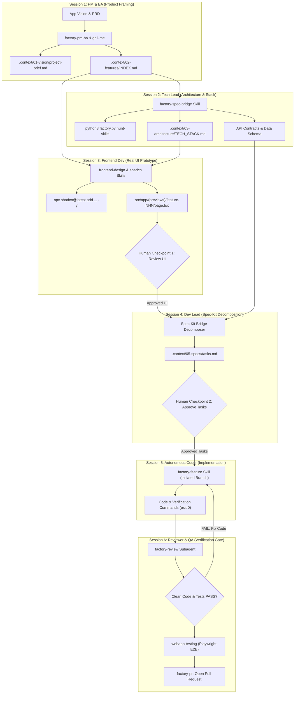

# AI Software Factory

An autonomous, multi-agent software engineering factory designed for production-grade development. This architecture replaces chaotic "vibe coding" with an asynchronous, multi-session pipeline governed by **Strict Context Isolation**, **Spec-Driven Development (SDD)**, and **Test-Driven Verification (TDD)**.

---

## 1. The Core Philosophy: Isolated Context Sessions

Running an entire software lifecycle (PM, BA, Architect, Frontend, Backend, Reviewer, QA) within a single AI conversation context is an anti-pattern:
* It causes **context window bloat** and token exhaustion.
* It injects conversational noise and outdated requirements into code generation.
* It induces role confusion and AI hallucinations.

### The Solution: The Git-Backed Context Bus (`.context/`)
In this factory, **each role operates in its own completely fresh, isolated session**. Agents never read chat transcripts from previous roles; they communicate strictly by reading and writing **Standardized Living Artifacts** committed to the repository:

```text
my-project/
├── .context/
│   ├── 01-vision/            # Session 1 (PM): High-level brief & boundaries
│   ├── 02-features/          # Session 1 (BA): Feature backlog & BDD acceptance criteria
│   ├── 03-architecture/      # Session 2 (Tech Lead): Tech stack, DB schema, API contracts
│   └── 05-specs/             # Session 4 (Dev Lead): Atomic sub-tasks ready for Developer Agent
│
├── src/
│   ├── app/(previews)/       # Session 3 (FE Dev): Live preview components with mock data
│   └── components/ui/        # Installed via official shadcn CLI (never hand-crafted)
```

---

## 2. End-to-End Isolated Context Architecture



---

## 3. Directory Layout & Architecture

```text
AI Factory/
├── AGENTS.md                          # The Factory Constitution (Roles, Rules, Mandates)
├── README.md                          # Master System Documentation & Setup Guide
├── factory.py                         # Root CLI Entrypoint (Automation & Bridge)
│
├── core/                              # Core Factory Engines (Organized by Role)
│   ├── pm-ba/                         # Role 1: PM & BA Feature Decomposer
│   ├── spec-bridge/                   # Role 2: Tech Lead Spec-Kit Engine & Templates
│   │   ├── factory_bridge.py          # Bridge CLI automation logic
│   │   └── templates/                 # Standardized Markdown templates
│   │       ├── project-brief-template.md
│   │       ├── feature-template.md
│   │       ├── plan-template.md
│   │       ├── tasks-template.md
│   │       └── state-template.md
│   │
│   └── dev-factory/                   # Role 4 & 5: Autonomous Developer & QA Engine (TDD, Review, Fix)
│
├── .agents/                           # Universal Agent Configuration (Discovered automatically)
│   ├── rules/                         # Project-Wide Non-Negotiable Coding Rules
│   │   └── clean-code.md              # Clean Code Mandates, Strict Types & English Rule
│   │
│   └── skills/                        # 44+ Curated Skills Mapped to 6 Distinct Roles
│       ├── factory-pm-ba/             # Role 1: PM & BA
│       ├── factory-spec-bridge/       # Role 2: Tech Lead & Architect
│       ├── frontend-design/           # Role 3: UI Design & Aesthetics
│       ├── shadcn/                    # Role 3: shadcn/ui Component Manager
│       ├── factory-feature/           # Role 4: Autonomous Coder (TDD)
│       ├── factory-review/            # Role 5: Independent Reviewer
│       ├── webapp-testing/            # Role 5: QA E2E Browser Testing (Playwright)
│       └── factory/                   # Role 6: Factory Orchestrator
│
└── .context/                          # The Living Context Bus (Git-tracked artifacts)
    ├── 01-vision/                     # PM Vision & Project Brief
    ├── 02-features/                   # BA Feature Backlog & BDD Acceptance Criteria
    ├── 03-architecture/               # Tech Lead Tech Stack, Schemas & Contracts
    └── 05-specs/                      # Decomposed Atomic Sub-tasks for Developer Agent
```

---

## 4. Role-to-Skill Mapping & Context Matrix

| Session | Role | Tools / Skills | Context Loaded (Input) | Artifacts Delivered (Output) |
|---|---|---|---|---|
| **Session 1** | PM & BA | `factory-pm-ba`, `grill-me`, `grilling`, `spec-driven-development` | Human prompts, RFP / PRD documents | `.context/01-vision/project-brief.md`<br/>`.context/02-features/*.md` |
| **Session 2** | Tech Lead | `factory-spec-bridge`, `grill-with-docs`, `domain-modeling`, `improve-codebase-architecture`, `api-and-interface-design`, `hunt-skills` | `.context/02-features/INDEX.md` | `.context/03-architecture/TECH_STACK.md`<br/>`DATA_SCHEMA.md`, `API_CONTRACTS.ts` |
| **Session 3** | Frontend Dev | `frontend-design`, `shadcn` | `.context/02-features/NNN.md`<br/>`TECH_STACK.md` | `src/app/(previews)/feature-NNN/page.tsx`<br/>Installed shadcn components |
| **Session 4** | Dev Lead | `factory-spec-bridge`, `factory.py` | Feature file + Architecture + Preview component | `.context/05-specs/NNN/plan.md`<br/>`.context/05-specs/NNN/tasks.md` |
| **Session 5** | Coder | `factory-feature`, `code-simplification`, TDD engine | Exactly ONE sub-task from `tasks.md` | Production code, unit tests, test logs (`exit code 0`) |
| **Session 6** | Reviewer & QA | `factory-review`, `diagnosing-bugs`, `performance-optimization`, `webapp-testing` | Git diff between feature branch & main | Review audit report, Playwright E2E test runs, Pull Request |

---

## 5. Setup Guide (Prerequisites & Installation)

### Prerequisites
- **Node.js**: v18+ (`node -v`)
- **Python**: v3.10+ (`python3 --version`)
- **Git**: Installed and configured (`git --version`)
- **GitHub CLI**: Logged in (`gh auth status`)
- **AI Coding Agent**: Google Antigravity or Claude Code

### Step 1: Open AI Factory Workspace
All role engines (`pm-ba`, `spec-bridge`, `dev-factory`) and configurations are pre-bundled in this repository:
```bash
cd "AI Factory"
```

### Step 2: Install Global Skills (One-Time Setup)
All 44+ core skills are pre-installed in `.agents/skills/`. To make them accessible globally to any session on your machine:
```bash
# Copy all skills to global agent directory
mkdir -p ~/.agents/skills
cp -r .agents/skills/* ~/.agents/skills/

# Verify installed skills
ls -1 ~/.agents/skills/
```

### Step 3: Test Factory CLI
```bash
python3 factory.py --help
```

---

## 6. Execution Playbook (Running Each Session)

### Session 1: Product Definition (PM & BA)
Open a **new chat session** in Antigravity or your IDE:
```text
Use skill factory-pm-ba. I want to build an application called "PulseStatus" - an incident management and public status page platform for technical teams.
```
* **What happens**: The agent clarifies requirements, establishes MVP boundaries, writes `.context/01-vision/project-brief.md`, and creates structured feature files in `.context/02-features/` with BDD Acceptance Criteria.
* **Human Checkpoint**: You review the feature list in chat and reply: *"Approved"*.

---

### Session 2: Technical Architecture (Tech Lead)
Open a **brand new chat session** (Clean Context):
```text
Use skill factory-spec-bridge. Read .context/02-features/INDEX.md and propose the technical architecture and tech stack for this application.
```
* **What happens**: The agent scans the requirements, determines the optimal framework (e.g. Next.js 15, Tailwind, shadcn/ui, Prisma), and runs `hunt-skills` if unknown packages are needed. It outputs `.context/03-architecture/TECH_STACK.md` and `API_CONTRACTS.ts`.
* **Human Checkpoint**: You review the architectural choices and reply: *"Approved"*.

---

### Session 3: Visual Prototyping (Frontend Dev)
Open a **brand new chat session** (Clean Context):
```text
Use skills frontend-design and shadcn. Build the preview UI component for feature .context/02-features/002-service-health.md using real shadcn components.
```
* **What happens**: 
  - The agent initializes shadcn if missing (`npx shadcn@latest init -d -y`).
  - Pulls official components via CLI (`npx shadcn@latest add badge card table dialog -y`).
  - Creates `src/app/(previews)/feature-002/page.tsx` with mock data.
* **Human Checkpoint**: Open your browser to the preview route, test buttons and responsive layouts. Reply: *"UI looks great, proceed"*.

---

### Session 4: Technical Task Decomposition (Spec-Kit)
Open a **brand new chat session** (Clean Context):
```text
Use skill factory-spec-bridge. Decompose feature .context/02-features/002-service-health.md into atomic sub-tasks ready for Developer Agent.
```
* **What happens**: The agent reads the BA feature, the architecture contracts, and the preview component. It creates `.context/05-specs/002-service-health/tasks.md` and runs `validate-spec` to verify that every sub-task contains file targets, step-by-step instructions, and test commands.
* **Human Checkpoint**: Dev inspects `tasks.md`, adjusts file paths if needed, and approves (`status: ready-to-code`).

---

### Session 5: Autonomous Implementation (Developer Agent)
Open a **brand new chat session** (Clean Context):
```text
Use skill factory-feature. Execute Sub-Task 1 from .context/05-specs/002-service-health/tasks.md.
```
* **What happens**: 
  - The Coder works on an isolated Git branch (`Workspace: branch`).
  - Follows Test-Driven Development (writes unit tests first).
  - Enforces all 7 Clean Code rules (no `any`, functions < 30 lines, early returns).
  - Executes terminal verification commands until exit code is `0`.

---

### Session 6: Independent Review & QA Gate
In the same or a fresh session:
```text
Use skill factory-review to audit the diff on the current branch against main.
```
* **What happens**: A fresh, independent reviewer subagent audits the code against the **Clean Code & Shadcn Integrity Checklist**. Once passed, `webapp-testing` runs Playwright E2E browser tests and `factory-pr` creates the Pull Request!

---

## 7. The Non-Negotiable Constitution (`AGENTS.md`)

1. **Strict English Mandate**: All tickets, specs, code, UI copy, commit messages, and PRs must be 100% in English.
2. **shadcn/ui CLI Rule**: Never manually craft files in `components/ui/`. Always install via `npx shadcn@latest add <component> -y`.
3. **No Styling Overrides in `className`**: The `className` prop on shadcn components is strictly reserved for layout (`w-full`, `mt-4`). Never override colors or padding inline; configure semantic tokens in `globals.css`.
4. **Dynamic Skill Hunting**: Proactively install missing skills via `python3 factory.py hunt-skills <tech>` before designing or coding.
5. **Clean Code Mandate**: Functions < 30 lines, components < 150 lines, early return guard clauses, 100% type-safety (zero `any`), zero dead code.
6. **Independent Review**: Coders never review their own code. Independent verification is required before merge.

---

## 8. Root CLI Quick Reference (`factory.py`)

```bash
# Initialize a new application's .context/ folder
python3 factory.py init "app-name"

# Sourcing dynamic skills online for any technology
python3 factory.py hunt-skills "prisma"
python3 factory.py hunt-skills "supabase"
python3 factory.py hunt-skills "docker"

# Scaffold a Technical Spec packet from a BA feature file
python3 factory.py make-spec ".context/02-features/002-feature.md"

# Validate that tasks.md has required sections before code generation
python3 factory.py validate-spec ".context/05-specs/002-feature/tasks.md"

# Export a clean prompt for an individual sub-task
python3 factory.py export-prompt ".context/05-specs/002-feature/tasks.md" 1
```
