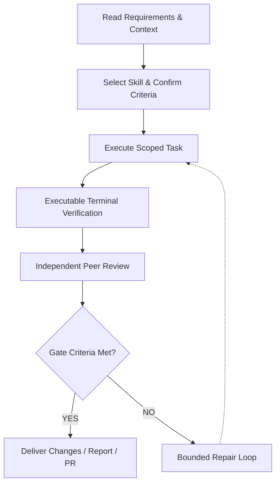

# Autonomous Developer & QA Factory Engine

A comprehensive suite of autonomous skills enabling AI agents to orchestrate software engineering tasks with verifiable criteria, delegated roles, executable test verification, and independent peer review.

**1 orchestrator skill + 12 specialized task skills**, bundled with evidence logging tools and a local execution dashboard.

---

## Quick Setup

### Requirements

- An AI coding agent supporting local skills (Google Antigravity, Claude Code, etc.).
- Python **3.10+** and Git available in `PATH`.
- Project build and runtime tools (e.g. Node.js, test runners, or browser for E2E).
- Helper tools use Python standard library only; no extra `pip install` required.

---

## Skill Directory & Capabilities

| Skill | When to Use | Primary Deliverable |
|---|---|---|
| [`factory`](factory/SKILL.md) | Orchestrate complex, multi-stage workflows | Guided workflow execution |
| [`factory-feature`](factory-feature/SKILL.md) | Implement new software behavior via TDD | Production feature + verified tests |
| [`factory-fixbug`](factory-fixbug/SKILL.md) | Fix defects or behavioral regressions | Minimal repair + failing-before/passing-after proof |
| [`factory-cifix`](factory-cifix/SKILL.md) | Diagnose and resolve failed CI / builds | Scoped fix based on exact failing run/logs |
| [`factory-testgap`](factory-testgap/SKILL.md) | Add missing test coverage for critical paths | Added regression tests while preserving behavior |
| [`factory-traceability`](factory-traceability/SKILL.md) | Map requirements to code and test cases | Traceability matrix (Requirement → Code → Test) |
| [`factory-investigate`](factory-investigate/SKILL.md) | Investigate root causes or audit behavior | Evidence-backed report; preserves repository state |
| [`factory-review`](factory-review/SKILL.md) | Independently audit diff, branch, or PR | Structured audit report; does not modify code |
| [`factory-design`](factory-design/SKILL.md) | Decide software architecture or implementation | Decision-ready design proposal |
| [`factory-refactor`](factory-refactor/SKILL.md) | Restructure code while preserving behavior | Refactored code + characterization test proof |
| [`factory-docs`](factory-docs/SKILL.md) | Update technical documentation | Verified, accurate documentation updates |
| [`factory-resume`](factory-resume/SKILL.md) | Resume an existing recorded factory run | Restores task context, bounds, and criteria |
| [`factory-pr`](factory-pr/SKILL.md) | Deliver verified changes to a Pull Request | Clean commit + PR delivery |

---

## Unified Execution Framework



- **Independent Review**: Reviewers operate in an isolated subagent or session, preventing self-approval bias.
- **Evidence Freshness**: Tests, reviews, and git diffs must match the current commit tree hash.
- **TDD Requirement**: Bugfixes require an explicit reproduction (red-before) and proof of resolution (green-after).
- **Execution Bounds**: Bounded retry loops (default: 3 iterations or 60 minutes) to prevent infinite repair loops.

---

## Local Verification Dashboard

Launch the local factory monitoring dashboard:
```bash
python3 "$HOME/.agents/skills/factory/scripts/factory_dashboard.py" serve --port 8421
```
Open [http://127.0.0.1:8421](http://127.0.0.1:8421) to inspect registered runs, test evidence, review verdicts, and execution blockers.

---

## Test the Factory Suite

From this directory:
```bash
python3 -m unittest discover -s tests -v
```

---

## License
MIT License. See [LICENSE](LICENSE) and [THIRD_PARTY_NOTICES.md](THIRD_PARTY_NOTICES.md).
