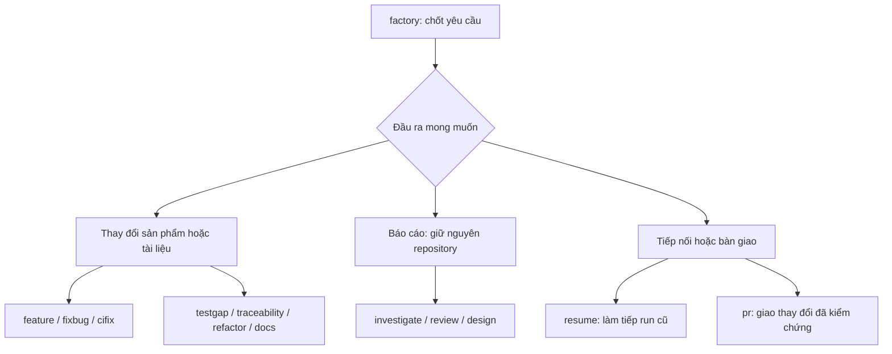

# Sơ đồ và so sánh 12 skill con

`factory` là cửa vào chung. Nó chọn skill chuyên biệt theo đầu ra bạn muốn và áp dụng quy trình, vai trò agent, bằng chứng dùng chung.

## Ba nhóm để dễ hình dung

Đây là cách chia nhóm để đọc tài liệu, không phải các loại run mới. `resume` và `pr` giữ loại việc gốc. `traceability` chỉ đọc/lập bảng sẽ dùng chế độ `investigation`.

## Nhóm thay đổi

| Skill | Luồng riêng | Điều cần chứng minh |
|---|---|---|
| **feature** | Hành vi mới → triển khai → test/xem UI | Tính năng được nối vào luồng thật và đạt tiêu chí; UI cần kiểm tra trực tiếp khi có thay đổi |
| **fixbug** | Tái hiện → sửa tối thiểu → đỏ trước/xanh sau | Cùng test thất bại trên bản gốc vì đúng lỗi và thành công sau sửa |
| **cifix** | Đọc run/log → phân loại → sửa → xác nhận | Thay đổi giải quyết lỗi của run gốc; kiểm tra CI trên đúng SHA khi có quyền truy cập và được phép |
| **testgap** | Tìm khoảng trống → thêm test → kiểm tra độ nhạy | Test bắt được hành vi sai khi có thể thử; hành vi sản phẩm được giữ nguyên |
| **traceability** | Yêu cầu → điểm vào code → test → kết quả chạy | Test thật sự khẳng định yêu cầu, có kết quả đúng phiên bản; nêu rõ chỗ thiếu/mơ hồ |
| **refactor** | Ghi nhận hành vi → đổi cấu trúc → kiểm tra tương thích | API và hành vi quan sát được được giữ; độ phức tạp giảm |
| **docs** | Xác minh thông tin → sửa tài liệu → review | Ví dụ, đường dẫn và hướng dẫn khớp nguồn hiện tại; docs checks khi có |

## Nhóm báo cáo

Các báo cáo được lưu ngoài cây source, trong hồ sơ run. Repository đích được giữ nguyên và nội dung báo cáo được review độc lập.

| Skill | Luồng riêng | Đầu ra và điểm phân biệt |
|---|---|---|
| **investigate** | Quan sát → giả thuyết → thử nghiệm → kết luận | Báo cáo nguyên nhân nếu xác định được, bằng chứng, câu hỏi mở và bước tiếp theo |
| **review** | Chốt diff/baseline → đọc nơi gọi → xác định lỗi → báo cáo | Nhận xét có vị trí và tác động; báo cáo có thể hoàn thành dù code bị đánh giá FAIL |
| **design** | Bài toán/ràng buộc → so sánh phương án → quyết định | Thiết kế có căn cứ, rủi ro và kế hoạch kiểm chứng; chưa triển khai code |

## Nhóm tiếp nối và bàn giao

| Skill | Luồng riêng | Điều cần giữ |
|---|---|---|
| **resume** | Nạp trạng thái cũ → xác nhận blocker/thay đổi → làm phần còn lại | Loại việc, tiêu chí và tổng giới hạn đã dùng; bằng chứng cũ có thể hết hiệu lực |
| **pr** | Kiểm tra bằng chứng → commit/tạo PR → xác nhận URL/SHA | Đúng nội dung đã kiểm chứng; nêu CI còn chờ; merge/deploy là phạm vi riêng |

## Chọn nhanh

- “Thêm khả năng mới” → **feature**; “đang làm sai kỳ vọng” → **fixbug**.
- “Vì sao xảy ra?” → **investigate**; “hãy sửa” → **fixbug**.
- “Thiếu test” → **testgap**; “mỗi yêu cầu được test ở đâu?” → **traceability**.
- “Nên xây theo cách nào?” → **design**; “hãy xây cho hoạt động” → **feature**.
- “Đọc và nhận xét nhánh này” → **review**; không tự sửa lỗi tìm được.
- “Tiếp tục lần trước” → **resume**; “đưa thay đổi đã kiểm chứng lên PR” → **pr**.

## Không cố định số agent

Việc nhỏ có thể do điều phối viên lập kế hoạch và thực hiện, sau đó dùng reviewer độc lập. Việc lớn có thể thêm researcher/planner và các implementer sở hữu phần việc riêng. Sơ đồ logic không có nghĩa mỗi bước luôn là một agent khác nhau.

Nguồn: [skill điều phối](../factory/SKILL.md), [workflow](../factory/references/workflow.md), [vai trò](../factory/references/agents.md), [bằng chứng](../factory/references/evidence.md) và các `SKILL.md` được liên kết trong [README](../README.md#chọn-skill-nào).
